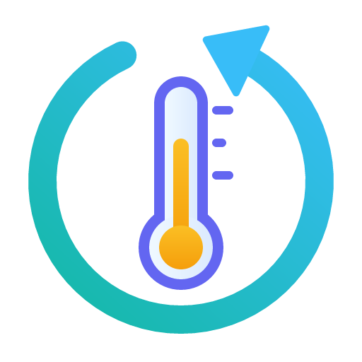

<div dir="rtl">

<p align="center">
  
</p>

<h1 align="center">Tuya Keep</h1>

<h3 align="center">הערך האחרון של כל חיישן Tuya, מיד אחרי הפעלה מחדש,<br>ובלי התראות עשן שגויות.</h3>

<p align="center"><a href="README.md">English</a></p>

---

## מה מקבלים

| | בלי Tuya Keep | עם Tuya Keep |
|---|---|---|
| **אחרי הפעלה מחדש** | חיישני Tuya מציגים **לא ידוע** עד שעה | לכל חיישן מספרים של Tuya יש **חיישן נלווה "ערך אחרון"** שמציג מיד את הערך האחרון, מסומן כלא חי. **חיישני Tuya לא משתנים** |
| **גלאי עשן** | **"זוהה עשן"** כל כמה שעות, בלי עשן, וזה נשאר | **אין התראות שווא** מערכים לא מוכרים. **אזעקה אמיתית לא נפגעת** |
| **סוללות שנגמרו** | מכשיר שהפסיק לדווח לא מורגש | הוא **מופיע כשקט**, עם הזמן שבו נראה לאחרונה |

עובד על כל מכשירי Tuya, הקיימים והעתידיים, בלי שום הגדרה למכשיר. Tuya Keep עובד לצד אינטגרציית Tuya הרשמית: הוא לא מחליף אותה ולא משנה את הקבצים שלה. כש-Home Assistant יתקן את הבעיות בעצמו, פשוט מסירים אותו.

---

## בעיה 1: "לא ידוע" אחרי הפעלה מחדש

אחרי הפעלה מחדש של Home Assistant, או טעינה מחדש של אינטגרציית Tuya, חלק ממכשירי Tuya מציגים **לא ידוע** בחיישנים שלהם:

- חיישני טמפרטורה ולחות (הנפוץ ביותר),
- מכשירים אחרים על סוללה או "ישנוניים" (תת-מכשירי Zigbee או Bluetooth מאחורי רכזת),
- לפעמים גם אחוז סוללה, עוצמת אור וערכים דומים.

הם נשארים **לא ידוע** עד הדיווח הבא של המכשיר, ואצל מכשירים כאלה זה יכול לקחת **15 עד 60 דקות ויותר**. בינתיים בלוחות הבקרה כתוב "לא ידוע" (כרטיסי מד מציגים **"הישות אינה מספרית"**), אוטומציות ותבניות שמשתמשות בערך נכשלות, בגרפים יש חור, וכל אפליקציה שקוראת מ-Home Assistant מציגה נתונים שגויים. אפליקציית Tuya מציגה כל הזמן את הערכים הנכונים.

**למה:** האינטגרציה הרשמית קוראת את המכשירים דרך ממשק השיתוף של אפליקציית Smart Life / Tuya. אצל חלק מהמכשירים, בעיקר מכשירי סוללה שישנים רוב הזמן, הממשק מחזיר **מצב ריק** כשהאינטגרציה עולה, ואז אין לה מה להציג עד שהמכשיר שולח דיווח חדש. גם חיישני Tuya לא משחזרים את המצב האחרון שלהם. הבעיה דווחה: [home-assistant/core#178105](https://github.com/home-assistant/core/issues/178105).

## בעיה 2: התראות עשן שגויות

חלק מגלאי העשן של Tuya (נראה בגלאי Wi-Fi מדגם "Smoke alarm") מציגים ב-Home Assistant **זוהה עשן** כל כמה שעות, בלי עשן, ונשארים כך. הגלאי לא מצפצף ואפליקציית Tuya לא מראה כלום.

**למה** (נמצא ברישום המפורט של Tuya): בבדיקה השגרתית שלו הגלאי שולח בשדה העשן ערך שההגדרה שלו עצמו לא מכירה, למשל `"23"`, כשההגדרה מכירה רק `"1"`/`"alarm"` ו-`"2"`/`"normal"`. התוכנה של Tuya שהאינטגרציה הרשמית משתמשת בה הופכת כל ערך שהיא לא יודעת לתרגם ל**ערך הראשון ברשימה**, ובגלאים האלה זה `"alarm"`. אחר כך הגלאי לא שולח "תקין" (מבחינתו לא הייתה אזעקה), ולכן ההתראה השגויה נשארת.

## מה Tuya Keep עושה

### 1. שומר את הערך האחרון (בלי חשבון, בלי אינטרנט)

- עוקב אחרי כל חיישן של אינטגרציית Tuya הרשמית וזוכר את **הערך האמיתי האחרון** שלו, עם הזמן שבו נראה לאחרונה.
- **חיישנים נלווים (ברירת המחדל):** ליד כל חיישן מספרים של Tuya הוא מוסיף חיישן משלו, *"&lt;שם&gt; ערך אחרון"*, באותו מכשיר. כל עוד חיישן Tuya מדווח, החיישן הנלווה מציג אותו ערך (`live: true`). כשחיישן Tuya הופך ל**לא ידוע**, החיישן הנלווה ממשיך להציג את הערך האחרון, מסומן כלא חי (`live: false`, `last_seen`, סמל היסטוריה), ואחרי הגבלת הגיל גם הוא הופך ללא ידוע. הוא משחזר את עצמו אחרי הפעלה מחדש בדרך הרגילה של Home Assistant. **בישויות של Tuya עצמן לא נוגעים אף פעם**, כמו שהמפתחים של Tuya ב-Home Assistant ממליצים. מפנים כרטיס בלוח או אוטומציה לחיישן הנלווה כשרוצים את הערך האחרון הידוע, ולחיישן Tuya כשרוצים רק ערכים חיים.
- **בתוך החיישן (רשות, הדרך של הגרסאות הראשונות):** הערך האחרון נכתב בחזרה לתוך חיישן Tuya עצמו, מסומן בשתי תכונות. הגדרות שנוצרו לפני גרסה 1.4.0 נשארות במצב הזה עד שמשנים.
- עובד על **כל מכשירי Tuya, הקיימים והעתידיים**, בלי שום הגדרה למכשיר. בעלייה הראשונה הוא לוקח את הערכים האחרונים מ**היסטוריית ה-Recorder**, כך שהוא עוזר כבר מההפעלה מחדש הראשונה.

### 2. מתעלם מערכים לא מוכרים (התיקון להתראות השווא)

- עומד לפני מטפל הדיווחים של התוכנה של Tuya ו**מתעלם מערך שלא נמצא לא במיפוי של השדה ולא בטווח שלו**. המצב פשוט נשאר כמו שהיה.
- ערכים אמיתיים (`"1"`, `"alarm"`, `"2"`, `"normal"` וכו') עוברים בלי שינוי, כך ש**אזעקה אמיתית לעולם לא מוסתרת**.
- עובד לכל מכשיר Tuya עם שדה כזה, לא רק לגלאי עשן. פועל כברירת מחדל.
- התיקון הנכון לכל דגם הוא קובץ תיקון (quirk) בפרויקט [tuya-device-handlers](https://github.com/home-assistant-libs/tuya-device-handlers) ([הוספת ערכי ENUM חסרים](https://github.com/home-assistant-libs/tuya-device-handlers/blob/main/docs/adding-missing-enum-values.md)), והבאג של ברירת המחדל שייך ל-[tuya-device-sharing-sdk](https://github.com/tuya/tuya-device-sharing-sdk). עד אז ההגנה הזאת מכסה כל דגם.

### 3. מראה מה קורה

חיישנים חיים בדף שלו: אילו חיישנים מציגים עכשיו ערך שמור, **אילו השתתקו** (לא דיווחו שעות: לרוב סוללה ריקה או מכשיר מחוץ לטווח, דבר ש-Home Assistant עצמו לא מבחין בו), אילו עלו "לא ידוע" בעלייה האחרונה, ואילו ערכים לא מוכרים נחסמו. ראו "מה רואים ב-Home Assistant" בהמשך.

### 4. רשות: ערכים אמיתיים מענן Tuya

עם המפתחות של פרויקט ענן משלך ב-Tuya IoT (חינם), כמה שניות אחרי הפעלה מחדש הוא קורא את **הערכים האחרונים האמיתיים** של המכשירים שהמצב שלהם חזר ריק, ומוסר אותם למסלול העדכון של האינטגרציה הרשמית עצמה, כאילו המכשירים דיווחו עכשיו. מהענן נלקחים רק ערכים מספריים, אף פעם לא מצבי התראה או הפעלה. אם משהו נכשל, חלק 1 ממשיך לעבוד.

## התקנה

### HACS (מומלץ)

1. HACS ← תפריט שלוש הנקודות ← **Custom repositories**.
2. מוסיפים את `https://github.com/ronenmaster/ha-tuya-keep`, סוג **Integration**.
3. מחפשים **Tuya Keep** ב-HACS ומורידים.
4. **מפעילים מחדש את Home Assistant.**

גרסאות חדשות מופיעות ב-HACS לבד (HACS בודק מאגרים מותאמים אישית כל כמה שעות; *שלוש נקודות ← עדכון מידע* בודק מיד). אחרי עדכון מפעילים מחדש את Home Assistant.

### ידנית

1. מורידים את המאגר (Code ← Download ZIP) ופותחים.
2. מעתיקים את התיקייה `custom_components/tuya_keep` לתיקיית ההגדרות של Home Assistant, כך שיהיה `<config>/custom_components/tuya_keep/manifest.json` ושאר הקבצים לידו. `<config>` היא התיקייה שבה נמצא `configuration.yaml` (‏`/config` ב-Home Assistant OS; בהתקנת Docker, תיקיית המחשב שממופה ל-`/config`).
3. **מפעילים מחדש את Home Assistant.**

## הגדרה

1. **הגדרות ← מכשירים ושירותים ← הוספת אינטגרציה ← Tuya Keep.**
2. מאשרים. זהו: הגדרה אחת מכסה את כל מכשירי Tuya.

אינטגרציית Tuya הרשמית צריכה להיות מוגדרת כרגיל. Tuya Keep עובד רק לצידה.

## הגדרות

**הגדרות ← מכשירים ושירותים ← Tuya Keep ← הגדרה.** שמירה טוענת מחדש את Tuya Keep, בלי הפעלה מחדש.

| הגדרה | ברירת מחדל | מה היא עושה |
|---|---|---|
| איך לשמור את הערך האחרון | חיישנים נלווים | *חיישנים נלווים* (מומלץ): חיישן "ערך אחרון" ליד כל חיישן Tuya, וחיישני Tuya לא משתנים. *בתוך חיישן Tuya עצמו*: הערך נכתב לתוכו (הדרך של הגרסאות הראשונות; הגדרות מלפני 1.4.0 נשארות כך). |
| לשמור ערך לכל היותר | 24 שעות | ערך שמור ישן יותר לא מוצג: החיישן הנלווה (במצב "בתוך החיישן": חיישן Tuya) מציג לא ידוע עד שהמכשיר ידווח. 0 = בלי הגבלה. |
| לשמור גם ערכי טקסט | כבוי | כבוי: רק מספרים (טמפרטורה, לחות, סוללה, הספק...). פועל: גם מצבי טקסט כמו `low` או `charging`. |
| אינטגרציות למעקב | `tuya` | החיישנים של האינטגרציות האלה במעקב. `tuya` היא האינטגרציה הרשמית. |
| חיישנים שלא לגעת בהם | אין | החיישנים האלה לעולם לא מוחזרים. |
| התעלמות מערכים לא מוכרים (התראות שווא) | פועל | ערך שהמכשיר לא מגדיר לא נכנס, במקום להופיע כערך הראשון ברשימה (בגלאי עשן: "אזעקה"). ערכים אמיתיים לא נפגעים. |
| שקט אחרי | 6 שעות | חיישן במעקב שלא שלח ערך חדש זמן כזה מופיע ב"חיישנים שקטים". 0 = כבוי. |
| קריאת הערכים האמיתיים מענן Tuya | לא בשימוש | חלק הענן (רשות). |

## מה רואים ב-Home Assistant

**הגדרות ← מכשירים ושירותים ← Tuya Keep ← השירות *Tuya Keep*** מציג חיישנים חיים:

| חיישן | מה הוא מראה |
|---|---|
| *&lt;שם&gt; ערך אחרון* (אחד לכל חיישן מספרים של Tuya, באותו מכשיר) | במצב חיישנים נלווים: הערך האמיתי האחרון של החיישן; `live` אומר אם הוא חי עכשיו, `last_seen` מתי דווח באמת. |
| מציגים ערך שמור עכשיו | כמה חיישנים מציגים ברגע זה ערך שמור. בתכונות: השמות שלהם, ולכל אחד מתי הערך נמדד באמת. |
| חיישנים במעקב | כמה חיישנים במעקב; בתכונות מופיעה הרשימה. |
| ערכים שהוחזרו מאז ההפעלה | כמה פעמים הוחזר ערך מאז ש-Home Assistant עלה. |
| החזרה אחרונה | מתי הוחזר ערך בפעם האחרונה. |
| חיישנים שקטים | חיישנים במעקב שלא שלחו ערך חדש יותר מ"שקט אחרי", עם הזמן שבו כל אחד נראה לאחרונה. |
| עלו כ"לא ידוע" בעלייה האחרונה | אילו חיישנים עלו "לא ידוע" בהפעלה האחרונה של Home Assistant או בטעינה מחדש של Tuya. כשזה נשאר 0 אחרי כמה הפעלות, כנראה שהאינטגרציה הרשמית תיקנה את בעיה 1. |
| ערכים לא מוכרים שנחסמו | כמה ערכים לא מוכרים נחסמו מאז העלייה; התכונה `recent` מראה את האחרונים (מכשיר, שדה, ערך, זמן). |
| ערכים שמולאו מהענן, מצב הענן | רק עם חלק הענן: כמה ערכים אמיתיים הגיעו מהענן, והאם הקריאה האחרונה הצליחה (`last_error` אומר למה לא). |

הרשימות הארוכות לא נשמרות ב-Recorder, כך שהן לא מגדילות את מסד הנתונים.

**רק במצב "בתוך החיישן":** לערך שמור שנכתב לחיישן Tuya יש את התכונות האלה (כלי מפתחים ← מצבים):

```yaml
tuya_keep_restored: true
tuya_keep_last_seen: "2026-01-01T10:15:00+00:00"   # מתי המכשיר באמת דיווח אותו
```

הן נעלמות כשהמכשיר מדווח שוב.

**אבחון:** Tuya Keep ← שלוש נקודות ← *הורדת אבחון* מציג רק מספרים. אף פעם לא מפתחות ולא שמות ישויות.

## רשות: ערכים אמיתיים מענן Tuya

צריך חשבון מפתחים חינמי בפלטפורמת Tuya IoT וכ-10 דקות. אפשר לדלג.

1. נכנסים ל-[platform.tuya.com](https://platform.tuya.com) ונרשמים (חשבון נפרד מהאפליקציה).
2. **Cloud ← Development ← Create Cloud Project**: ‏Industry *Smart Home*, ‏Development method **Smart Home**, ‏Data center **באותו אזור כמו חשבון אפליקציית Smart Life / Tuya** (רוב אירופה, המזרח התיכון ואפריקה: *Central Europe*; אמריקה: *Western America* או *Eastern America*; סין: *China*; הודו: *India*).
3. בפרויקט פותחים **Service API** ומוודאים ש-**IoT Core** מאושר (בדרך כלל מראש).
4. **Devices ← Link Tuya App Account ← Add App Account**, וסורקים את קוד ה-QR באפליקציית Smart Life (או Tuya): *אני ← סמל הסריקה*. השלב הזה חובה: בלעדיו הענן עונה "permission deny".
5. בעמוד **Overview** של הפרויקט מעתיקים את **Access ID** ואת **Access Secret**.
6. ב-Home Assistant: **Tuya Keep ← הגדרה ← קריאת הערכים האמיתיים מענן Tuya**: בוחרים מרכז נתונים ומדביקים את שני המפתחות. הם נבדקים לפני השמירה.

Tuya Keep רק **קורא** (קריאה אחת לכל מכשיר שצריך, רק אחרי הפעלה מחדש או טעינה מחדש) ולעולם לא שולח פקודות. את התוכנית החינמית "IoT Core" של Tuya צריך לפעמים לחדש בפלטפורמה (Cloud ← Cloud Services).

## מגבלות

- במצב חיישנים נלווים: לוח או אוטומציה שצריכים להמשיך לעבוד דרך הפעלה מחדש צריכים להצביע על החיישן הנלווה "ערך אחרון", לא על חיישן Tuya.
- ערך שמור הוא **הערך האחרון הידוע**, לא ערך חי. לכן הוא מסומן ויש לו הגבלת גיל.
- מוחזרות רק ישויות `sensor`. חיישנים בינאריים (דלת, תנועה, עשן...) לא מוחזרים, בכוונה: "תקין" או "זוהה" ישן יכול להיות מסוכן.
- ההגנה מפני ערכים לא מוכרים מכסה מכשירים שמדווחים לפי מספר שדה (רוב מכשירי ה-Wi-Fi); גם ערך שהיה לו משמעות אבל לא מוגדר אצל המכשיר עצמו נחסם. התראת שווא שכבר הוצגה לפני ההתקנה נעלמת בהפעלה מחדש הבאה.
- לחיישן שאף פעם לא דיווח בזמן ש-Tuya Keep (או ה-Recorder) עבדו, אין מה להחזיר.
- חלק הענן תלוי בממשק של Tuya; אם Tuya ישנו אותו, החלק הזה יפסיק לעזור והשאר ימשיך.

## פרטיות

- הכול, חוץ מחלק הענן, עובד בתוך Home Assistant שלך. שום דבר לא יוצא מהבית.
- חלק הענן מדבר רק עם הממשק הרשמי של Tuya, עם מפתחות הפרויקט שלך, ורק קורא. המפתחות נשמרים כמו של כל אינטגרציה אחרת ומוסתרים מהאבחון.
- אין טלמטריה, אין אנליטיקס, אין שרתים אחרים.

## מתי להסיר

- **בעיה 1:** עוקבים אחרי [home-assistant/core#178105](https://github.com/home-assistant/core/issues/178105) ואחרי החיישן "עלו כ"לא ידוע" בעלייה האחרונה": כשהוא נשאר 0 אחרי כמה הפעלות, כנראה שהתיקון הגיע.
- **בעיה 2:** היא בהמרת הערכים של התוכנה של Tuya; עד שזה ישתנה, הסרת Tuya Keep מחזירה את התראות השווא (אפשר לכבות רק את שאר החלקים בהגדרות).

להסרה: **הגדרות ← מכשירים ושירותים ← Tuya Keep ← שלוש נקודות ← מחיקה** (קובץ הערכים השמורים נמחק איתו), מסירים מ-HACS ומפעילים מחדש. אין שום דבר לבטל באינטגרציה הרשמית.

## דיווח על בעיה ל-Home Assistant

לפני שמדווחים ל-Home Assistant על בעיה ב-Tuya, **משחזרים אותה כש-Tuya Keep מושבת** (הגדרות ← מכשירים ושירותים ← Tuya Keep ← שלוש נקודות ← השבתה, ואז הפעלה מחדש), כמו שהמפתחים מבקשים: Tuya Keep משנה את הדרך שבה ערכי Tuya מגיעים. בעיות ב-Tuya Keep עצמו מדווחים ב-[issues של המאגר הזה](https://github.com/ronenmaster/ha-tuya-keep/issues), לא ב-Home Assistant.

## פתרון תקלות

| מה רואים | מה לבדוק |
|---|---|
| חיישן Tuya מציג לא ידוע אחרי הפעלה מחדש | זה צפוי במצב חיישנים נלווים: בחיישן Tuya לא נוגעים. מסתכלים על החיישן הנלווה "ערך אחרון" שלו (`sensor.<name>_last`). |
| החיישן הנלווה (או, במצב "בתוך החיישן", החיישן עצמו) עדיין לא ידוע | האם היה ערך אמיתי ב-24 השעות האחרונות (או בהגבלה שלך)? לחיישן חדש לגמרי עוד אין מה לשמור. האם האינטגרציה של החיישן היא `tuya`? |
| גלאי עשן עדיין מראה עשן | התראת שווא מלפני העדכון נעלמת בהפעלה מחדש הבאה. אחר כך בודקים את "ערכים לא מוכרים שנחסמו": בתכונה `recent` רואים מה נחסם. אזעקה אמיתית (`"1"` או `"alarm"`) לעולם לא נחסמת. |
| ערכים מוחזרים אבל ישנים מאוד | להקטין את "לשמור ערך לכל היותר", או להגדיר את חלק הענן. |
| חיישן מופיע כשקט | לבדוק את הסוללה והטווח שלו; מתי נראה לאחרונה כתוב בתכונות. |
| ענן: "ענן Tuya דחה את המפתחות" | מרכז הנתונים צריך להתאים לפרויקט. להעתיק שוב את המפתחות מעמוד Overview. |
| הענן נשמר אבל הערכים עדיין שמורים | לקשר את חשבון האפליקציה לפרויקט (שלב 4). לבדוק באבחון: `cloud.last_error`. |
| רוצים לראות מה הוא עושה | להוסיף ל-`configuration.yaml`: `logger:` ← `logs:` ← `custom_components.tuya_keep: debug`. |

## הבהרה

אין קשר ל-Tuya או ל-Home Assistant, לא בחסות ולא באישור שלהם. "Tuya" ו-"Smart Life" הם שמות של בעליהם, ומופיעים כאן רק כדי לתאר עם מה זה עובד.

## רישיון

[MIT](LICENSE)

</div>
