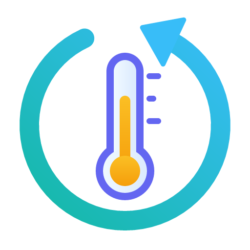

# Tuya Keep

**Tuya sensors keep their last value after a Home Assistant restart, instead of showing "Unknown" for up to an hour.**

A small, temporary companion for the **official Tuya integration** of Home Assistant. It does not replace the official integration and does not change its code. When Home Assistant fixes the problem itself, you simply remove Tuya Keep.

[עברית](README.he.md)

---

## Contents

- [The problem](#the-problem)
- [Why it happens](#why-it-happens)
- [What Tuya Keep does](#what-tuya-keep-does)
- [Install](#install)
- [Set up](#set-up)
- [Settings](#settings)
- [Optional: real values from the Tuya cloud](#optional-real-values-from-the-tuya-cloud)
- [How to see that it works](#how-to-see-that-it-works)
- [How it works (details)](#how-it-works-details)
- [Limits](#limits)
- [Privacy](#privacy)
- [When to remove it](#when-to-remove-it)
- [Troubleshooting](#troubleshooting)
- [Development](#development)

---

## The problem

After you restart Home Assistant, or reload the Tuya integration, some Tuya devices show **Unknown** for their sensors:

- temperature and humidity sensors (very common),
- other battery powered or "sleepy" devices (Zigbee or Bluetooth sub-devices behind a gateway),
- sometimes battery level, illuminance and similar values.

They stay **Unknown** until the device sends its next report, which for these devices can take **15 to 60 minutes or more**. Meanwhile:

- dashboards show "Unknown", and gauge cards show **"Entity is non-numeric"**,
- automations and templates that use the value fail or do the wrong thing,
- history graphs have a hole after every restart,
- any app or tablet that reads Home Assistant shows wrong data.

The Tuya app on your phone shows the right values the whole time, which makes it look like Home Assistant is broken.

## Why it happens

The official integration reads your devices through Tuya's **"Smart Life / Tuya app" sharing API**. When the integration starts, it asks that API for the list of devices and their current status.

For some devices, mainly battery devices that sleep most of the time, **the API returns an empty status**. The integration then has nothing to show, so every sensor of that device is **Unknown**. Values arrive only when the device itself pushes a new report over Tuya's message channel (MQTT), which may be an hour away.

Two more facts make it worse:

- Tuya sensors in Home Assistant do not restore their last state on start (most integrations' sensors don't; they rely on the device).
- The integration has no other source for the last values.

The problem is reported upstream: [home-assistant/core#178105](https://github.com/home-assistant/core/issues/178105). Some people moved to the custom "Xtend Tuya" integration because it shows values right away: it also reads the device "shadow" (the last values Tuya's cloud keeps) through Tuya's IoT platform. Tuya Keep brings that idea to the **official** integration, plus a fallback that needs no cloud account at all.

## What Tuya Keep does

Two layers. The first one always works and needs nothing. The second one is optional.

### Layer 1: keep the last value (no account, no internet)

- Tuya Keep watches every sensor of the official Tuya integration and remembers its **last real value**, with the time it was last seen.
- When such a sensor turns **Unknown** (after a restart, a reload, or when the device goes online/offline and the cloud status is empty), Tuya Keep **puts the last value back** at once.
- The value is marked with two attributes, so you always know it is a kept value and how old it is.
- The device's next real report replaces it, as usual.
- It works for **every current and future Tuya device**: new devices are watched automatically, nothing to set per device.
- On the first start after you install it, it takes the last values from the Home Assistant **recorder history**, so it helps from the very first restart.

### Layer 2 (optional): read the real values from the Tuya cloud

- If you give Tuya Keep the keys of your own (free) **Tuya IoT cloud project**, then a few seconds after a restart it reads the **real last values** of the devices whose status came back empty.
- It hands those values to the **official integration's own update path**, exactly as if the devices had just reported them. The official entities then show real values, not kept ones.
- If anything fails (no internet, wrong keys, an account that is not linked, a Tuya change), nothing breaks: layer 1 stays in charge.

## Install

### HACS (recommended)

1. HACS → three dots menu → **Custom repositories**.
2. Add `https://github.com/ronenmaster/ha-tuya-keep`, type **Integration**.
3. Find **Tuya Keep** in HACS and download it.
4. **Restart Home Assistant.**

### Manual

1. Download this repository (Code → Download ZIP) and unpack it.
2. Copy the folder `custom_components/tuya_keep` into your Home Assistant configuration folder, so that you have:

   ```
   <config>/custom_components/tuya_keep/__init__.py
   <config>/custom_components/tuya_keep/manifest.json
   ...
   ```

   `<config>` is the folder that holds `configuration.yaml`. In Home Assistant OS and Supervised it is `/config` (reach it with the Samba, SSH or File editor add-on). In a Docker / Container install it is the host folder mapped to `/config`.
3. **Restart Home Assistant.**

## Set up

1. **Settings → Devices & services → Add integration → Tuya Keep.**
2. Confirm. That's all: one entry covers all Tuya devices.

The official Tuya integration must be set up as usual. Tuya Keep only works next to it.

## Settings

**Settings → Devices & services → Tuya Keep → Configure.**

| Setting | Default | What it does |
|---|---|---|
| Keep a value for at most | 24 h | A kept value older than this is not put back; the sensor stays Unknown until the device reports. 0 = no limit. |
| Also keep text values | off | Off: only numbers (temperature, humidity, battery, power...). On: also text states such as `low` or `charging`. |
| Integrations to watch | `tuya` | Sensors of these integrations are watched. `tuya` is the official Tuya integration. You can add others that have the same "Unknown after restart" behavior. |
| Sensors to leave alone | none | These sensors are never restored. |
| Read real values from the Tuya cloud | not used | The optional layer 2. See below. |

Saving the settings reloads Tuya Keep; no restart is needed.

## Optional: real values from the Tuya cloud

This needs a free developer account on the Tuya IoT platform and about 10 minutes. You can skip it; layer 1 works without it.

1. Go to [platform.tuya.com](https://platform.tuya.com) (Tuya IoT platform) and sign up (a separate account from the app).
2. **Cloud → Development → Create Cloud Project**:
   - Industry: Smart Home. Development method: **Smart Home**.
   - Data center: the **same region as your Smart Life / Tuya app account**. If you are not sure: most of Europe, the Middle East and Africa use *Central Europe*; the Americas use *Western America* (or *Eastern America*); China uses *China*; India uses *India*.
3. In the project, open **Service API** and make sure **IoT Core** is authorized (it usually is by default).
4. **Devices → Link Tuya App Account → Add App Account**, then scan the QR code with the Smart Life (or Tuya) app: *Me → scan icon*. Your devices now appear in the project. This step is required: without it the cloud answers "permission deny".
5. On the project's **Overview** page copy the **Access ID** (Client ID) and the **Access Secret** (Client Secret).
6. In Home Assistant: **Tuya Keep → Configure → Read real values from the Tuya cloud**: choose the data center and paste the two keys. Tuya Keep checks the keys before saving.

Notes:

- Tuya Keep only **reads** the last values (one call per device that needs it, only after a restart or reload). It never sends commands to devices.
- Tuya's free "IoT Core" plan has a monthly call quota and may need to be **renewed** from time to time in the Tuya IoT platform (Cloud → Cloud Services). Tuya Keep uses very few calls.
- Without this layer you still get the kept values from layer 1.

## How to see that it works

1. Restart Home Assistant.
2. Open **Developer tools → States** and look at a Tuya temperature sensor.
3. A kept value has these attributes:

   ```yaml
   tuya_keep_restored: true
   tuya_keep_last_seen: "2026-01-01T10:15:00+00:00"   # when the device really reported it
   ```

4. When the device reports again, the attributes disappear and the value is live again.

With layer 2 working, the values after a restart are real ones, so these attributes usually don't appear at all.

You can use the attributes in templates, for example:

```jinja

  last known value, seen {{ relative_time(as_datetime(state_attr('sensor.my_sensor_temperature', 'tuya_keep_last_seen'))) }} ago

```

**Diagnostics:** Tuya Keep → three dots → *Download diagnostics* shows counts only (how many sensors are watched, how many values were restored, the cloud layer's results). It never includes keys or entity names.

## How it works (details)

- **Which sensors:** every `sensor` entity in the entity registry whose integration (platform) is in *Integrations to watch* (default `tuya`), minus *Sensors to leave alone*. The list is checked live, so devices added later are covered at once.
- **Remembering:** each real state (and each repeated report of the same value) updates the kept value and its time. Values are saved in `.storage/tuya_keep.last_values` (written at most once a minute, and on shutdown). Values not seen for 30 days are dropped.
- **Restoring:** when a watched sensor's state becomes `unknown`, Tuya Keep writes the kept value into Home Assistant's state machine, with the sensor's own attributes (unit, device class, name) plus `tuya_keep_restored` and `tuya_keep_last_seen`. The "unknown" state reaches every other listener first, then the restored one follows, so nothing gets the two out of order.
- **First start:** if a sensor has no kept value yet, the newest real value in the recorder history (last 10 days, within the age limit) is used.
- **Never touched:** `unavailable` (the device is offline: that is the truth), entities of other integrations, excluded sensors, values older than the limit.
- **Cloud layer:** reads `GET /v2.0/cloud/thing/{device_id}/shadow/properties` of Tuya's OpenAPI, signed with your project keys, only for devices whose status is missing values, and only values the device has none of (so it never overwrites a fresher report). The values are passed to the Tuya SDK's own report handler, the same path a real device report takes. Each device is read once per start or reload of the official integration; network errors are retried up to 3 times, a refusal (for example "permission deny") is not retried.

## Limits

- A kept value is the **last known** value, not a live one. That's why it is marked, and why there is an age limit.
- Only `sensor` entities. Binary sensors (door, motion, smoke...) are not restored on purpose: an old "clear" or "detected" could be dangerous.
- A sensor that never reported a value while Tuya Keep (or the recorder) was running has nothing to restore.
- Kept values are written to the recorder like any state, so the history shows the value continuing through the restart.
- The cloud layer depends on Tuya's OpenAPI. If Tuya changes it, the layer stops helping and layer 1 continues.

## Privacy

- Layer 1 works completely inside your Home Assistant. Nothing leaves your home.
- Layer 2 talks only to Tuya's official API, with your own project keys, and only reads.
- Keys are stored in Home Assistant's config entry like every other integration's keys, and are hidden from diagnostics.
- No telemetry, no analytics, no other servers.

## When to remove it

Watch [home-assistant/core#178105](https://github.com/home-assistant/core/issues/178105). When a Home Assistant release fixes it (the official Tuya sensors show values right after a restart):

1. **Settings → Devices & services → Tuya Keep → three dots → Delete.** Its stored values file is deleted with it.
2. Remove it from HACS (or delete `custom_components/tuya_keep`).
3. Restart Home Assistant.

Nothing in the official integration needs to be undone.

## Troubleshooting

| What you see | What to check |
|---|---|
| Still Unknown after a restart | Was there a real value in the last 24 h (or your limit)? A brand new sensor has nothing to keep yet. Is the sensor's integration `tuya` (Developer tools → States → the entity's settings)? |
| Values are restored but very old | Lower *Keep a value for at most*, or set up the cloud layer for real values. |
| Cloud layer: "The Tuya cloud refused these keys" | The data center must match the project. Copy the keys again from the project's Overview page. |
| Cloud layer saves, but values are still kept ones | Link the app account to the project (step 4). Check diagnostics: `cloud.last_error`. |
| I want to see what it does | Add to `configuration.yaml`: `logger:` → `logs:` → `custom_components.tuya_keep: debug`. |

## Development

```bash
pip install pytest-homeassistant-custom-component tuya-device-sharing-sdk
pytest
```

The tests include an end to end run with the real official Tuya integration and the real Tuya SDK, with the cloud replaced by an offline stand-in that returns an empty status (the bug itself).

## Disclaimer

Not affiliated with, endorsed by or connected to Tuya or Home Assistant. "Tuya" and "Smart Life" are names of their owners, used only to describe what this works with.

## License

[MIT](LICENSE)
